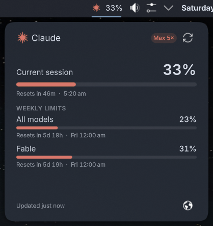
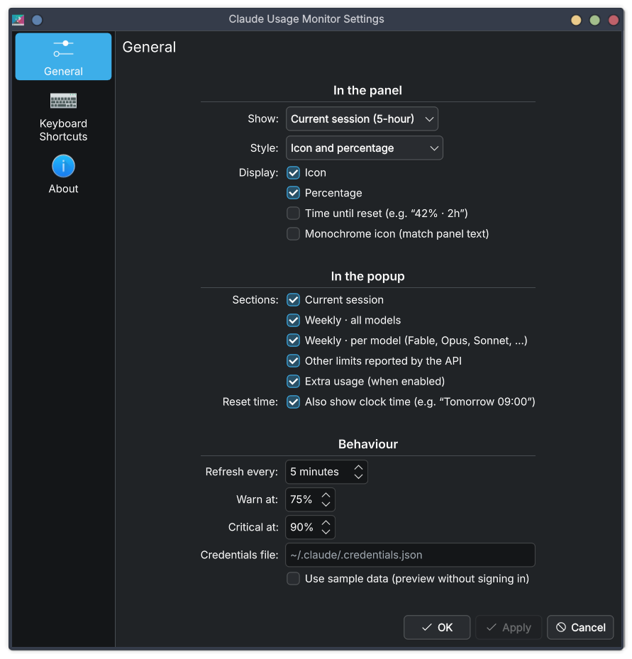

# Claude Usage Monitor Widget for KDE Plasma

KDE Plasma 6 widget that shows how much of your Claude plan you've used, and
when each limit resets.

<p align="center">
  
  
</p>

## Usage

This widget requires:

- KDE Plasma ≥6.0
- An authenticated Claude Code installation

### Installation

```bash
curl -fsSL \
  https://raw.githubusercontent.com/half0wl/kde-claude-usage-monitor-widget/main/install.sh \
  | bash
```

Installation script output:

```text
https://github.com/half0wl/kde-claude-usage-monitor-widget
Claude Usage Monitor for KDE Plasma

  → Downloading half0wl/kde-claude-usage-monitor-widget@main
  → Installing v1.0.0
  ✓ Installed

  To add the widget:
    1. Right-click your panel
    2. Add or Manage Widgets
    3. Search for "Claude Usage Monitor"
    4. Drag it onto a panel
```

### Uninstall

Remove the widget from your panels first (right-click it → Remove), then:

```bash
curl -fsSL \
  https://raw.githubusercontent.com/half0wl/kde-claude-usage-monitor-widget/main/uninstall.sh \
  | bash
```

## How It Works

The widget is pure QML/JavaScript and needs nothing beyond Plasma itself.

It reads Claude Code's `.credentials.json` for your current Claude credentials
(`~/.claude/` by default, or `$CLAUDE_CONFIG_DIR`, or the path set in the
widget's settings), and makes API calls to Anthropic to fetch
usage<sup>[[0]](#api-usage)</sup> and plan
information<sup>[[1]](#api-profile)</sup>.
The token is only held in memory during a refresh, goes only to
`api.anthropic.com`, and is never logged or saved anywhere.

<a id="api-usage"></a><sub>[0] <code>GET https://api.anthropic.com/api/oauth/usage</code></sub><br>
<a id="api-profile"></a><sub>[1] <code>GET https://api.anthropic.com/api/oauth/profile</code></sub>

## Disclaimer

This is an unofficial community project. It is not affiliated with, endorsed
by, or supported by Anthropic. Claude is a trademark of Anthropic. The API
endpoints that this project uses are undocumented and may change without
notice.

## License

[Copyright (c) 2026 Ray Chen \<meow@ray.cat\>](./LICENSE)
